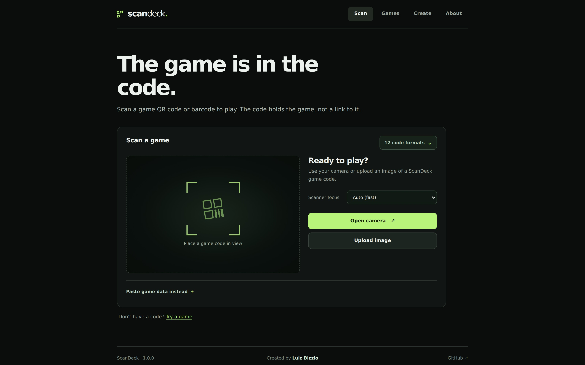
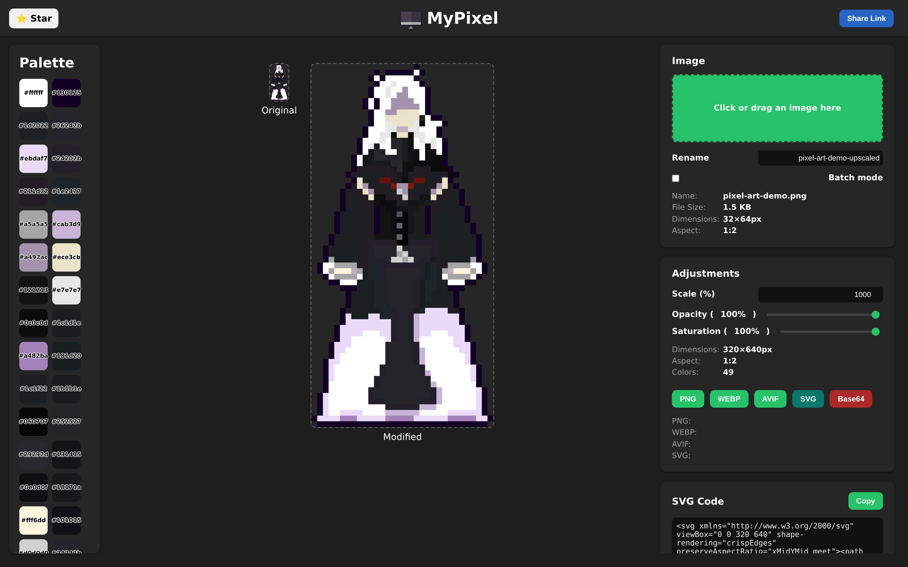
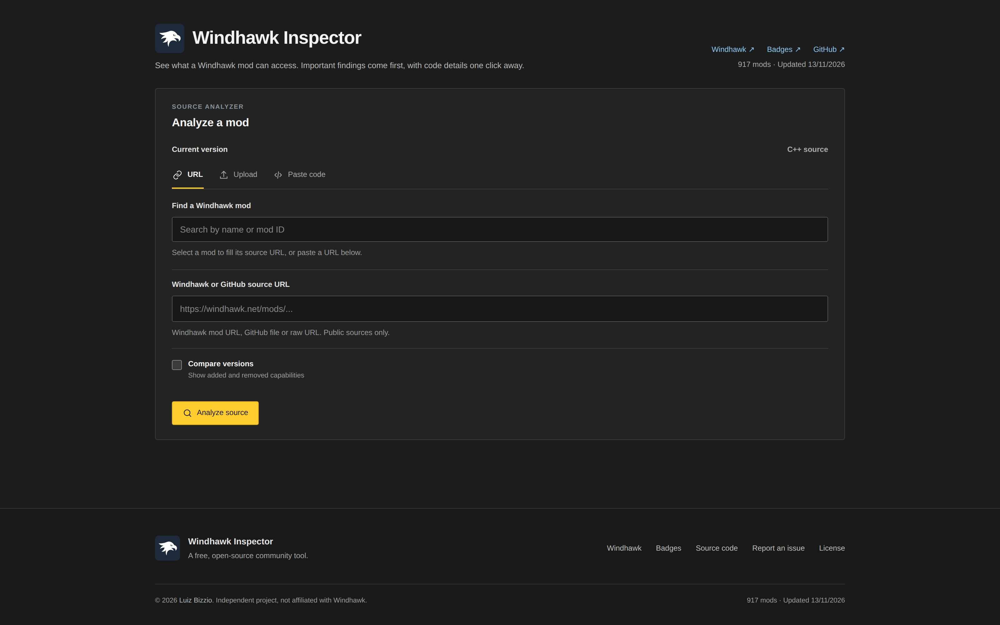
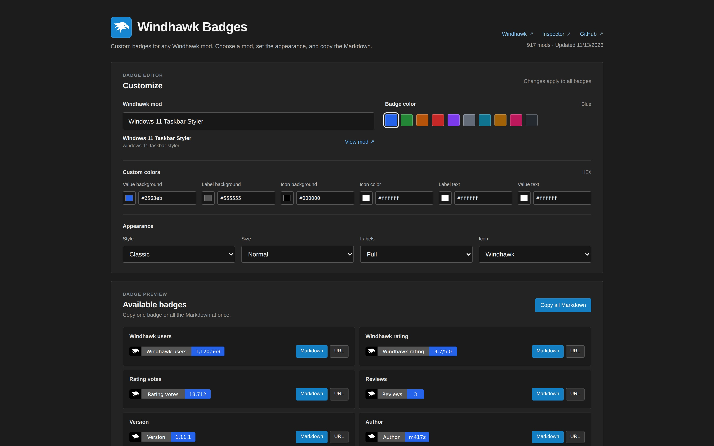

# Luiz Bizzio

**A visual index of my websites and open-source projects.**

Browse real work in a clean grid or explore it in an interactive 3D gallery.

[**Explore the website**](https://luizbizzio.com) · [**GitHub profile**](https://github.com/luizbizzio)

---

## About the project

This is my personal project index. It brings my websites, tools, experiments, games, and open-source work into one place.

Instead of a long list of links, each project has its own visual preview, description, details, and direct links. The goal is simple: make it easy to discover what I have built.

## Two ways to explore

| **Grid** | **3D Gallery** |
| :--- | :--- |
| Browse clear cards with real screenshots, project names, and details. | Move through a smooth 3D gallery built with Three.js. |
| Best for finding a specific project. | Best for exploring projects visually. |

Both views use the same collection. Switch between them without losing your place.

## Some of my websites

<table>
  <tr>
    <td width="50%" valign="top">
      
      <strong><a href="https://scandeck.luizbizzio.com/">ScanDeck</a></strong> 
      Small games stored inside QR codes and barcodes.
    </td>
    <td width="50%" valign="top">
      
      <strong><a href="https://mypixel.luizbizzio.com/">MyPixel</a></strong> 
      A simple pixel art editor that runs in the browser.
    </td>
  </tr>
  <tr>
    <td width="50%" valign="top">
      
      <strong><a href="https://windhawk-inspector.luizbizzio.com/">Windhawk Inspector</a></strong> 
      Explore and compare Windhawk mod source code.
    </td>
    <td width="50%" valign="top">
      
      <strong><a href="https://windhawk-badges.luizbizzio.com/">Windhawk Badges</a></strong> 
      Create live SVG badges for Windhawk mods.
    </td>
  </tr>
</table>

[**View all websites and projects**](https://luizbizzio.com)

## Features

- **Real previews:** website screenshots and locally saved project artwork.
- **Project details:** descriptions, dates, source links, and more information.
- **Visual history:** browse older screenshots when captures are available.
- **Fast search:** find a website or repository by name.
- **Command palette:** press `Ctrl + K` or `Cmd + K` for quick navigation.
- **Filters and sorting:** browse by category, name, or recent updates.
- **Multiple code hosts:** links to GitHub, GitLab, and Codeberg when available.
- **Responsive design:** a dark interface for desktop and mobile, with reduced-motion support.

## Built to work independently

The site uses locally stored screenshots, icons, and project information. It does not need the GitHub API to load when someone visits.

GitHub Actions helps keep the collection up to date by refreshing project data, checking code-host links, and capturing new website screenshots. The latest saved version stays available even if an external service is temporarily down.

## Technology

**HTML · CSS · JavaScript · Three.js · GitHub Actions · Cloudflare Pages**

The site is static, with no database or application server. Three.js is bundled with the project, so the 3D gallery does not need an external CDN.

---

Made by **[Luiz Bizzio](https://github.com/luizbizzio)**

[Website](https://luizbizzio.com) · [Source code](https://github.com/luizbizzio/luizbizzio.com) · [Apache 2.0 License](LICENSE)

